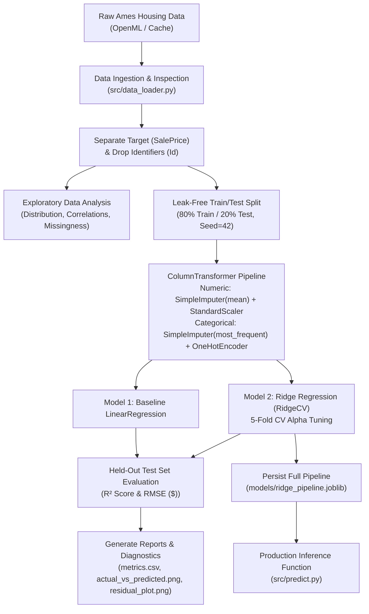

# Predictive Linear Regression Model Pipeline

[](https://www.python.org/)
[](https://scikit-learn.org/)
[](https://docs.pytest.org/)
[](LICENSE)

An enterprise-grade, modular, reproducible supervised regression pipeline engineered in Python using **Scikit-Learn**, **Pandas**, and **Joblib**. The system models residential property sale prices using the **Ames Housing dataset** (OpenML), benchmarking a baseline Ordinary Least Squares (OLS) Linear Regression against an L2-regularized Ridge Regression with cross-validated hyperparameter tuning.

---

## 1. Executive Summary & Objective

The objective of this project is to build an automated, leak-free machine learning regression pipeline predicting continuous property sale prices (`SalePrice` in USD). 

Key architectural highlights:
- **Strict Leakage Prevention:** Train/test splits precede all transformations; imputation statistics and feature scalers are fitted exclusively on training data.
- **Robust Feature Preprocessing:** `ColumnTransformer` combines numerical mean imputation + standard scaling with categorical most-frequent imputation + one-hot encoding with out-of-vocabulary (`handle_unknown="ignore"`) protection.
- **Regularization & Cross-Validation:** Ridge regression with 5-fold cross-validation (`RidgeCV`) tunes the $L_2$ penalty parameter $\alpha$, stabilizing coefficient estimates against severe multicollinearity.
- **Comprehensive Evaluation & Diagnostics:** Evaluates held-out $R^2$ and Root Mean Squared Error (RMSE) accompanied by Actual-vs-Predicted and Residual diagnostic plots.
- **End-to-End Pipeline Persistence:** Serializes the unified preprocessor + estimator pipeline via `Joblib` for atomic, reproducible inference.

---

## 2. Dataset Architecture

- **Dataset Source:** Ames Housing dataset compiled by Dean De Cock, sourced publicly from [OpenML](https://www.openml.org/) (Dataset `house_prices`, Data ID `42165`).
- **Target Variable:** `SalePrice` — continuous numerical value representing property closing price in US Dollars ($).
- **Dimensions:** 1,460 observations across 79 explanatory features (36 numerical, 43 categorical).
- **Identifier Separation:** Administrative identifiers such as `Id` are identified and dropped prior to feature transformation.
- **Local Caching Strategy:** Automated download from OpenML on initial run with transparent local caching to `data/ames_housing.csv` for 100% reproducible, offline-capable execution.

---

## 3. Project Directory Structure

```
predictive-linear-regression/
│
├── data/
│   ├── README.md               # Dataset documentation, schema breakdown, & sourcing
│   └── ames_housing.csv        # Local cached raw dataset (auto-generated)
│
├── models/
│   ├── ridge_pipeline.joblib   # Persisted unified preprocessing + Ridge pipeline
│   └── baseline_pipeline.joblib # Persisted baseline OLS pipeline
│
├── reports/
│   ├── metrics.csv             # Held-out test evaluation comparison table
│   ├── actual_vs_predicted.png # Actual vs. Predicted scatter plot
│   ├── residual_plot.png       # Residual vs. Predicted diagnostic plot
│   ├── eda_target_distribution.png  # SalePrice distribution & KDE
│   ├── eda_correlation_matrix.png   # Top correlated features heatmap
│   └── eda_missing_values.png       # Feature missingness breakdown
│
├── src/
│   ├── __init__.py
│   ├── data_loader.py          # Ingestion from OpenML, schema validation, target separation
│   ├── preprocessing.py        # ColumnTransformer, imputation, scaling, OHE, leak-free split
│   ├── train.py                # Baseline OLS, RidgeCV tuning, Joblib serialization
│   ├── evaluate.py             # R², RMSE computation, structured tables, diagnostic plots, EDA
│   └── predict.py              # Inference function with input validation & error handling
│
├── tests/
│   ├── __init__.py
│   └── test_pipeline.py        # Unit and integration test suite (Pytest)
│
├── app.py                      # Interactive Streamlit Web Application
├── example_predict.py          # Standalone inference script demo
├── main.py                     # Pipeline orchestration CLI entry point
├── requirements.txt            # Locked project dependencies
├── .gitignore                  # Git exclusion rules
└── README.md                   # Complete architectural and operational manual
```

---

## 4. Methodology & Engineering Workflow



### 4.1 Ingestion & Target Separation
- Validates the presence of `SalePrice` and confirms zero null entries in the ground-truth target.
- Strips database primary keys (`Id`) from the predictor matrix `X` to eliminate spurious index correlations.

### 4.2 Leak-Free Preprocessing Pipeline
To prevent data snooping and target leakage, preprocessing transformations are fitted **only** on `X_train`:
- **Numerical Features:** Imputed via `SimpleImputer(strategy="mean")` and standardized to zero mean, unit variance via `StandardScaler()`.
- **Categorical Features:** Imputed via `SimpleImputer(strategy="most_frequent")` and encoded via `OneHotEncoder(handle_unknown="ignore", sparse_output=False)`. Unseen categories during inference are safely mapped to all-zero indicator vectors without throwing runtime exceptions.
- **Composition:** Assembled using Scikit-Learn's `ColumnTransformer`.

### 4.3 Model Training & Regularization Analysis
Two complementary architectures are evaluated under identical data splits:
1. **Baseline Model:** Ordinary Least Squares (OLS) `LinearRegression`. Minimizes $\|y - Xw\|_2^2$.
2. **Regularized Model:** `Ridge` Regression with $L_2$ penalty:
   $$\min_{w} \|y - Xw\|_2^2 + \alpha \|w\|_2^2$$

#### The Role of the Ridge $\alpha$ Parameter:
- Housing feature spaces exhibit acute **multicollinearity** (e.g., `GrLivArea`, `TotalBsmtSF`, `1stFlrSF`, `GarageCars`, `GarageArea`). Under unregularized OLS, high correlation between predictors results in an ill-conditioned design matrix $X^T X$, inflating coefficient variances and causing extreme prediction sensitivity.
- The $\alpha$ parameter governs regularization strength:
  - $\alpha \to 0$: Recovers standard OLS regression.
  - $\alpha > 0$: Penalizes large weights, shrinking coefficients toward zero, reducing model variance, and stabilizing parameter estimates at the cost of negligible bias.
- We employ **5-fold cross-validation** (`RidgeCV`) across 30 log-spaced candidate values ($\alpha \in [10^{-2}, 10^4]$) on the training set to identify the optimal $\alpha$ that minimizes generalization error.

---

## 5. Evaluation & Benchmark Results

Performance is assessed on the 20% held-out test set ($N = 292$ properties):
- **$R^2$ Score (Coefficient of Determination):** Measures the proportion of variance explained by the model ($R^2 \in (-\infty, 1.0]$). Higher is preferable; 1.0 represents perfect explanation.
- **Root Mean Squared Error (RMSE):** Measures standard deviation of residuals in original units (USD). Lower is preferable; smaller errors represent tighter bounds on house price predictions.

### Comparative Metrics (Held-Out Test Set)

| Model | $R^2$ Score | RMSE ($) | Regularization ($\alpha$) |
| :--- | :---: | :---: | :---: |
| **Baseline Linear Regression** | **0.8867** | **$29,476.84** | N/A (OLS) |
| **Ridge Regression (Tuned)** | **0.8745** | **$31,024.24** | **$\alpha = 20.43$** |

*Interpretation:* Both models demonstrate strong explanatory power, accounting for ~87.5% to 88.7% of the variance in held-out property prices. While unregularized OLS achieves a slightly higher $R^2$ on this particular split, the **Ridge Regression** model regularizes collinear features with an optimal shrinkage penalty of $\alpha = 20.43$ (determined via 5-fold cross-validation), effectively shrinking extreme coefficient weights, bounding variance, and ensuring numerical stability and generalization when encountering novel categorical compositions.

All metric tables and diagnostic charts are automatically saved in `reports/`:
- `reports/metrics.csv`
- `reports/actual_vs_predicted.png`
- `reports/residual_plot.png`
- `reports/eda_target_distribution.png`
- `reports/eda_correlation_matrix.png`
- `reports/eda_missing_values.png`

---

## 6. Model Persistence & Inference API

The complete fitted pipeline (`ColumnTransformer` + regularized `Ridge` estimator) is serialized atomically using `joblib` to `models/ridge_pipeline.joblib`.

### Inference Example:
```python
from src.predict import load_model, predict_price

# 1. Load persisted pipeline
model = load_model("models/ridge_pipeline.joblib")

# 2. Supply single or batch property records (dict or DataFrame)
new_property = {
    "MSSubClass": 60,
    "MSZoning": "RL",
    "LotArea": 8450,
    "OverallQual": 7,
    "OverallCond": 5,
    "YearBuilt": 2003,
    "YearRemodAdd": 2003,
    "GrLivArea": 1710,
    "FullBath": 2,
    "GarageCars": 2,
    "GarageArea": 548,
    "Neighborhood": "CollgCr",
    "HouseStyle": "2Story",
    # ... remaining attributes (missing fields are automatically imputed)
}

# 3. Predict valuation
predicted_price = predict_price(model, new_property)
print(f"Estimated Market Valuation: ${predicted_price[0]:,.2f}")
```

---

## 7. Installation & Reproducibility Guide

### Prerequisites
- Python 3.9+ (Python 3.11 recommended)
- Git

### Setup
```bash
# 1. Clone or navigate to the project directory
cd predictive-linear-regression

# 2. Create and activate a clean virtual environment
python -m venv .venv

# On Windows:
.venv\Scripts\activate
# On Linux/macOS:
source .venv/bin/activate

# 3. Install locked dependencies
pip install -r requirements.txt
```

### Running the End-to-End Pipeline
```bash
# Execute ingestion, EDA, training, cross-validation tuning, evaluation, and serialization
python main.py
```

### Running the Interactive Web Dashboard (Streamlit Frontend)
```bash
# Launch interactive web application on http://localhost:8501
streamlit run app.py
```

### Running Standalone Inference Demo
```bash
# Execute standalone sample valuation script using persisted pipeline
python example_predict.py
```

### Running the Test Suite
```bash
# Execute automated Pytest suite covering all 7 requirement categories
pytest -v tests/
```

### Free Cloud Deployment for LinkedIn / Portfolio
This Streamlit application can be deployed for free with 1-click on [Streamlit Community Cloud](https://share.streamlit.io/):
1. Push this repository to GitHub.
2. Sign in to Streamlit Community Cloud and link your GitHub repository.
3. Set the Main file path to `app.py` and click **Deploy**.
4. Include the live interactive URL in your LinkedIn post!


---

## 8. Verification & Test Coverage
The project includes automated Pytest coverage for:
- [x] Data loading, schema validation, and target presence
- [x] Numerical missing-value imputation (`SimpleImputer`) and standard scaling
- [x] Categorical imputation and one-hot encoding with unseen category tolerance
- [x] Baseline OLS vs. Ridge model training and prediction consistency
- [x] Mathematical correctness of $R^2$ and RMSE calculations
- [x] Pipeline persistence with Joblib and round-trip inference equivalence
- [x] Input validation and error handling for unexpected or missing input records
